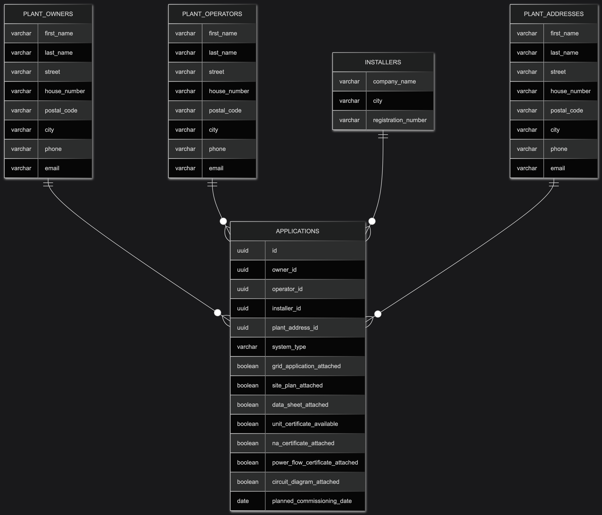
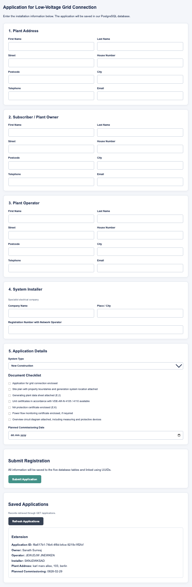
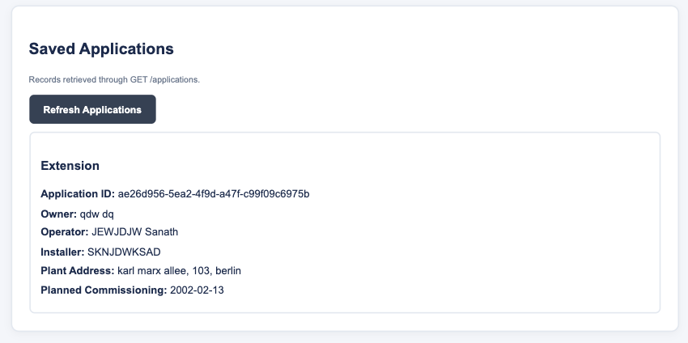

# Energy System Database

This project was developed for my Database Systems class at SRH University Berlin.

The assignment was to design a relational database based on a real-world scenario and make the data accessible through a REST API. I used an energy system registration form shared by our professor as the reference for the database structure.

The main focus was PostgreSQL and NestJS. I also added a simple frontend as an extra feature to make the application easier to test and to include the project in my GitHub portfolio.

## Technologies Used

- **Backend:** NestJS, TypeScript
- **Database:** PostgreSQL
- **ORM:** TypeORM
- **Frontend:** HTML, CSS, JavaScript
- **Other:** Docker, Mermaid

## Database Structure

The database consists of five tables:

| Table | Description |
|---|---|
| `plant_owners` | Stores information about the plant owner |
| `plant_operators` | Stores information about the plant operator |
| `installers` | Stores installer company details |
| `plant_addresses` | Stores the installation address and contact information |
| `applications` | Stores application details and connects the other four tables |

Each table has a UUID primary key.

The `applications` table contains four foreign keys referencing the corresponding owner, operator, installer, and plant address.

This keeps the data separated while allowing the information to be retrieved together when needed.

### Database Model



The database model was created using Mermaid.
The editable diagram is available in [model.mmd](model.mmd).

*Entity relationship diagram showing the five tables and how they connect.*

## REST API

I used NestJS and TypeORM to connect the application to PostgreSQL.

For this assignment, I implemented GET and POST endpoints to retrieve and insert records.

| Method | Endpoint | Description |
|---|---|---|
| GET | `/plant-owners` | Retrieve plant owners |
| POST | `/plant-owners` | Add a plant owner |
| GET | `/plant-operators` | Retrieve plant operators |
| POST | `/plant-operators` | Add a plant operator |
| GET | `/installers` | Retrieve installers |
| POST | `/installers` | Add an installer |
| GET | `/plant-addresses` | Retrieve plant addresses |
| POST | `/plant-addresses` | Add a plant address |
| GET | `/applications` | Retrieve applications |
| POST | `/applications` | Create an application |

### API Example

Creating a new plant owner using POST:

```json
{
  "first_name": "Anna",
  "last_name": "Weber",
  "city": "Berlin",
  "email": "anna@example.com"
}
```

The backend saves the information in PostgreSQL and generates a UUID for the new record.

## Frontend

The frontend wasn't required for the assignment, but I wanted to have a way to interact with the database without manually sending API requests.

I created a registration page where users can enter the information required by the form.

It includes:

- Plant address and contact information
- Plant owner details
- Plant operator details
- Installer company information
- System type
- Document and certificate checklist
- Planned commissioning date

The signing details were excluded from the implementation.

### Registration Page



When a user submits the form, the frontend sends POST requests to the NestJS backend.

The information is stored in the corresponding tables, and the generated UUIDs are used to link the records in the `applications` table.

The application also provides a section to view previously saved registrations using the GET endpoint.

### Saved Applications



## Project Setup

### Requirements

- Node.js and npm
- Docker
- PostgreSQL client or a VS Code PostgreSQL extension

### 1. Clone the Repository

```bash
git clone https://github.com/SanathNarayana/energy-system-database.git
cd energy-system-database
```

### 2. Start PostgreSQL

Set `POSTGRES_PASSWORD` in your terminal to a password of your choice for a new local database, or use your existing PostgreSQL password. You can save it in an ignored `.env` file at the project root. Keep the password file local.

From the main project directory:

```bash
docker compose up -d
```

The local PostgreSQL container is configured to use:

- Database: `energy_system_database`
- Host: `localhost`
- Port: `5433`

### 3. Set Up the Tables

Run the SQL statements in `model.sql` to create the five tables, UUID primary keys, and foreign-key relationships.

### 4. Start the Backend

Use the same terminal so the backend inherits `POSTGRES_PASSWORD`. If you saved it in a local `.env` file, load it from the project root first:

```bash
set -a
. ./.env
set +a
```

Then open the backend directory:

```bash
cd backend
npm install
npm run start:dev
```

### 5. Open the Application

Visit:

`http://localhost:3000`

The registration form and REST API are served by the NestJS backend.

## What I Learned

Working on this project helped me better understand how relational databases are structured and how primary and foreign keys connect different tables.

I also got practical experience using TypeORM with NestJS, running PostgreSQL through Docker, and creating GET and POST endpoints.

Adding the frontend helped me understand how the data moves from a user input form through the backend and into the database.

## Possible Improvements

There are a few things I'd like to improve as I continue working on the project:

- Add validation for user inputs
- Handle a complete registration using a single database transaction
- Improve error handling
- Add document uploads
- Add more API operations

For now, the project focuses on the database relationships and GET/POST functionality required for the assignment.

## Reference

I used the registration form shared by our professor as the reference for the database fields.

I also referred to [David Linner's NestJS database demo](https://github.com/davidlinner/nestjs-rdbms-demo) while working on the backend.

---

**Sanath Suresh**  
B.Sc. Web Development  
SRH University Berlin